```mermaid
flowchart LR

    A["External Recon<br/>BGP/DNS/OSINT/leaks"] --> B["Host & Service Discovery<br/>fping + nmap"]
    B --> C{"Have valid<br/>domain creds?"}

    %% Unauthenticated path
    C -- "No" --> D["Unauth User Enum<br/>Kerbrute / SMB Null Session / LDAP Anon Bind"]
    D --> E["Password Policy Enum<br/>rpcclient / enum4linux / ldapsearch"]
    E --> F["Password Spraying<br/>rpcclient loop / Kerbrute / CME"]
    F --> G{"Got a hit?"}
    G -- "No" --> F
    G -- "Yes" --> H["Credentialed Enum"]

    %% Credentialed path
    C -- "Yes" --> H
    H --> I["CME / SMBMap / rpcclient<br/>PowerView / AD Module / SharpHound"]
    I --> J["BloodHound Analysis<br/>Shortest Path to DA"]

    %% Branches off credentialed enum
    J --> K1["Kerberoasting<br/>GetUserSPNs.py / Rubeus"]
    J --> K2["ASREPRoasting<br/>GetNPUsers.py / Rubeus"]
    J --> K3["ACL Abuse<br/>Get-DomainObjectACL"]
    J --> K4["GPO Abuse<br/>Get-DomainGPO"]
    J --> K5["Misc Misconfigs<br/>Description field / GPP cpassword / SYSVOL scripts"]
    J --> K6["Named Vulns<br/>NoPac / PrintNightmare / PetitPotam / MS14-068"]

    K1 --> L["Crack Hash<br/>hashcat"]
    K2 --> L
    K3 --> M["Escalated Access<br/>password reset / group add / targeted roast"]
    K4 --> M
    L --> N{"Cracked /<br/>new access?"}
    N -- "Yes" --> O["New Foothold"]
    M --> O
    K5 --> O
    K6 --> P["Direct Domain Admin<br/>skip lateral movement"]

    O --> Q{"Local admin<br/>on a host?"}
    Q -- "Yes" --> R["Lateral Movement<br/>RDP / WinRM / MSSQL / PsExec / WMIExec"]
    Q -- "No" --> H

    R --> S{"Multi-hop<br/>via WinRM?"}
    S -- "Yes" --> T["Double Hop Workaround<br/>PSCredential object / Register-PSSessionConfiguration"]
    S -- "No" --> U["DCSync Rights?"]
    T --> U

    U -- "Yes" --> V["DCSync<br/>secretsdump.py / Mimikatz lsadump::dcsync"]
    U -- "No" --> R

    V --> W["Domain Compromised"]
    P --> W

    W --> X{"Additional domains<br/>/ trusts?"}
    X -- "Yes, child-parent" --> Y1["ExtraSids / Golden Ticket<br/>ticketer.py / Mimikatz / Rubeus golden"]
    X -- "Yes, cross-forest" --> Y2["Cross-Forest Kerberoast<br/>+ Foreign Group Membership"]
    X -- "No" --> Z["Engagement Complete<br/>Cleanup"]
    Y1 --> Z
    Y2 --> Z

    click A "AD-Enum-Attack-Cheatsheet.md" "Open full cheatsheet"
```

## Reading the graph
- **Diamonds** = decision points (do you have X yet?).
- **Rounded boxes** = actions/phases with the tool set to use.
- Two entry paths converge at *Credentialed Enum* — one from unauthenticated recon (no creds), one straight in if creds were provided or already obtained.
- *Named Vulns* (K6) is a shortcut lane: NoPac/PrintNightmare/PetitPotam/MS14-068 can jump straight to Domain Admin, bypassing the normal lateral-movement loop.
- The `H → I → J` loop is deliberately re-enterable: after any lateral move or new credential, cycle back through credentialed enum with the new context.

## 🔗 Related Notes
- [[AD-Enum-Attack-Cheatsheet]] — full command reference for every node above
- [[cpts-cert]] — HTB CPTS certification path
- [[mini-soc-lab]] — detection-side practice for these TTPs
